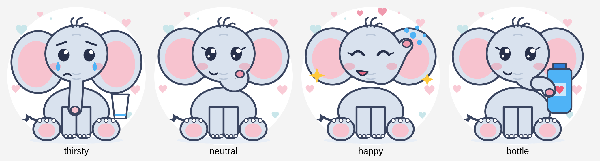

# Ellie 🐘 — a loving hydration buddy

An Android app with a small backend that gently reminds someone you love to drink water. The reminders come from **Ellie the elephant** and carry sweet messages:

- **Thirsty, sad Ellie** when he's falling behind. The reminder **keeps coming back** until he logs how much he drank, and he can type the amount right in the notification.
- **Happy Ellie saying "Kudos!"** every time he drinks, sometimes with a sourced health fact.
- **"Grab your bottle!" Ellie** when he leaves home (optional; uses on-device geofencing).
- A **daily goal based on his WHOOP data** (workouts and weight). It falls back to a standard goal without WHOOP.



> ⚠️ Goals are general-wellness heuristics, **not medical advice**. See [`backend/app/targets.py`](backend/app/targets.py) and check with a doctor for personal needs.

## Why it's built this way

| Constraint | Consequence |
|---|---|
| WHOOP's public API is **read-only**: third-party apps can't show notifications in the WHOOP app or write hydration data into it | WHOOP is a **data source** only. Notifications come from this app. |
| On Android 14+, users can swipe away even "ongoing" notifications | The reminder is **re-posted when dismissed**, with a back-off if he keeps dismissing so it never becomes a loop. |
| The WHOOP OAuth client secret must never ship inside an APK | A **tiny backend** does the OAuth exchange and stores the tokens encrypted. |
| Must work at the office, home, outside or playing sports | Reminders are **local-first** (WorkManager + encrypted Room DB) and work offline. The backend only refines the goal. |

```
WHOOP API (read-only, OAuth) ─► Backend (FastAPI) ──FCM "sync" ping (no data)──► Android app (Kotlin)
                                 • encrypted tokens                                • local reminders + re-post
                                 • daily goal calc                                 • typed amount in notification
                                 • validated messages                              • on-device home geofence
                                 • webhook HMAC + dedupe                           • SQLCipher DB, Keystore keys
```

## Repo layout

| Path | What |
|---|---|
| `android/` | Kotlin + Jetpack Compose app, with flavors `dev` / `qa` / `uat` / `prod` |
| `backend/` | FastAPI service, Dockerfile, tests |
| `backend/app/messages.yaml` | **Edit me!** 70 loving messages + 10 sourced health facts |
| `art/` | Elephant art generator (SVG + Android vectors) |
| `infra/` | Example deploy config (Fly.io) |
| `docs/` | [Setup guide](docs/SETUP.md) · [Security & threat model](docs/SECURITY.md) · [Limitations & things to verify](docs/LIMITATIONS.md) |

## Customise the messages

1. Edit `backend/app/messages.yaml`. Keep entries plain text, ≤ 200 characters, no links. Both the server and the phone reject links, for anti-phishing.
2. Run `cd backend && python -m app.cli export-messages` to bundle them into the app. CI fails if the two copies drift apart.
3. Redeploy the backend. The phone picks up the new messages on its next sync.

## Quick start (dev)

```bash
cd backend && python3 -m venv .venv && . .venv/bin/activate
```

```bash
pip install --require-hashes -r requirements.txt && pip install -r requirements-dev.in
```

```bash
pytest -q
```

The full dev→qa→uat→prod walkthrough is in [docs/SETUP.md](docs/SETUP.md).
