# Ellie: real emulator screenshots

Commit: ef92676 · Android 14 emulator (Pixel 6)

### 01_welcome

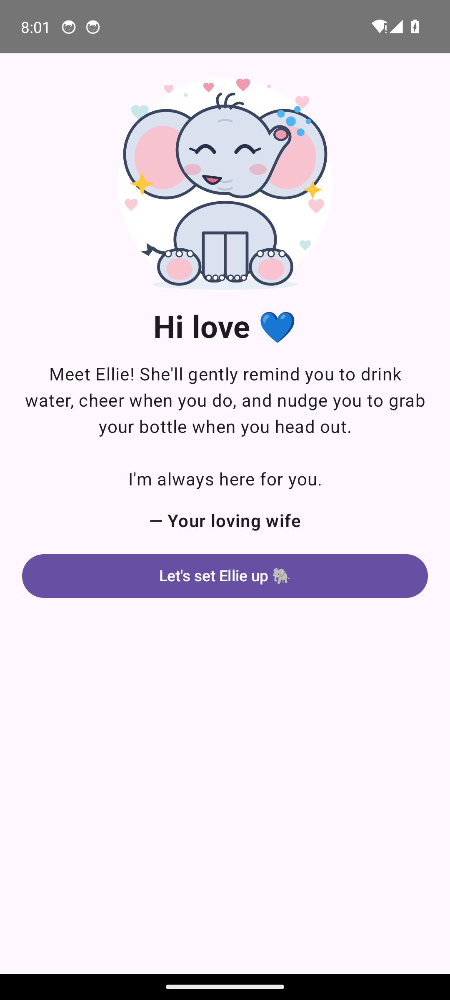

### 02_setup

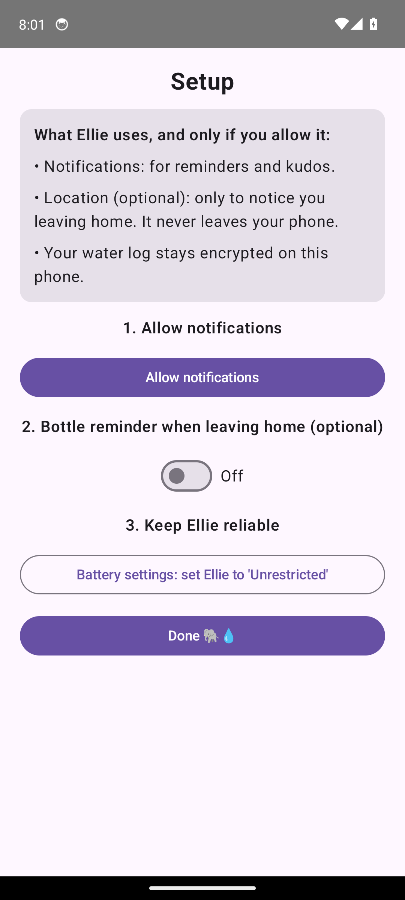

### 03_home_start

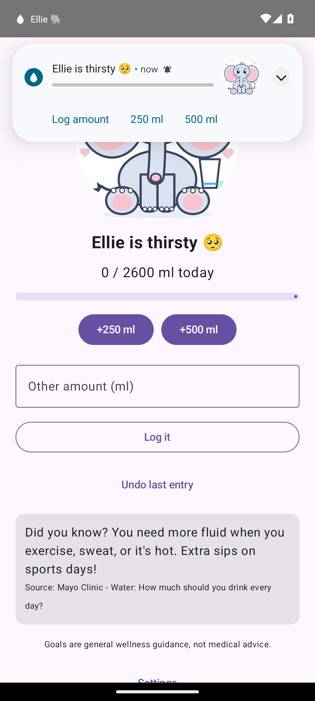

### 04_home_after_250

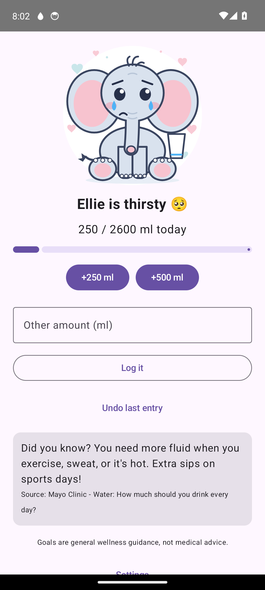

### 05_kudos_notification_expanded

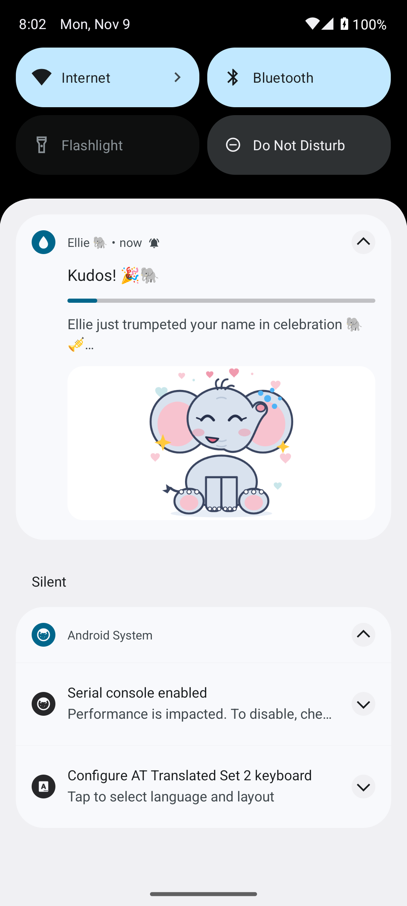

### 06_settings

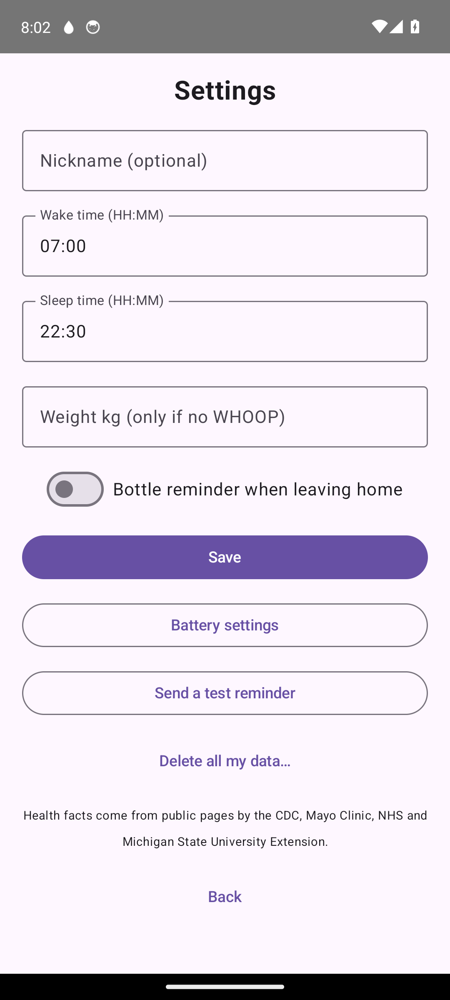

### 07_reminder_notification_expanded

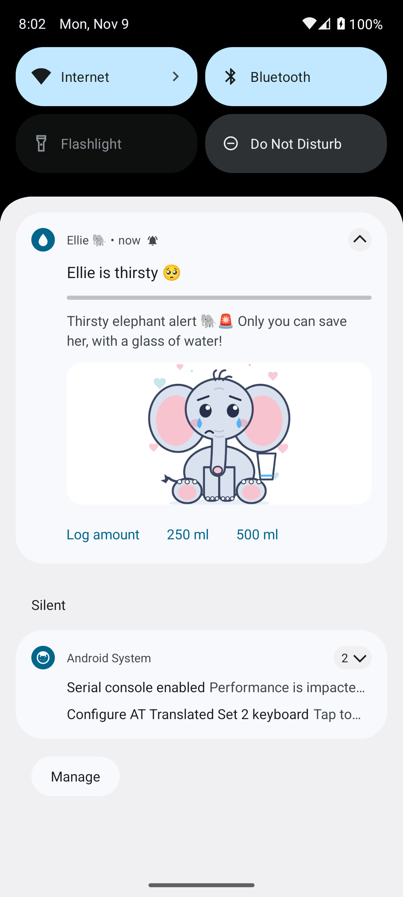

### 08_typing_amount

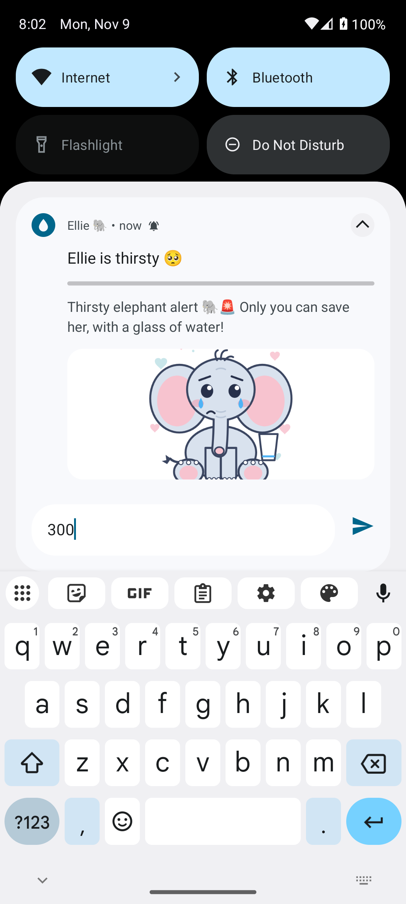

### 09_after_typed_300

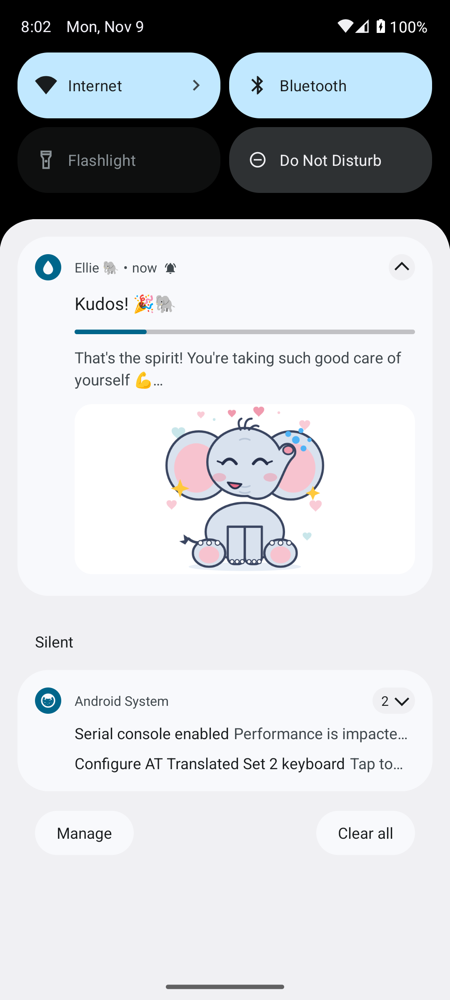

### 10_after_swipe_away_should_be_back

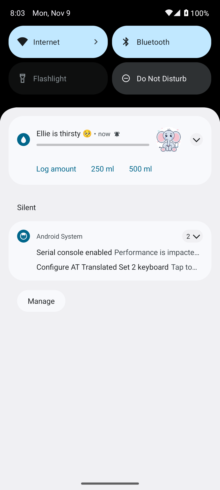

### 11_home_end

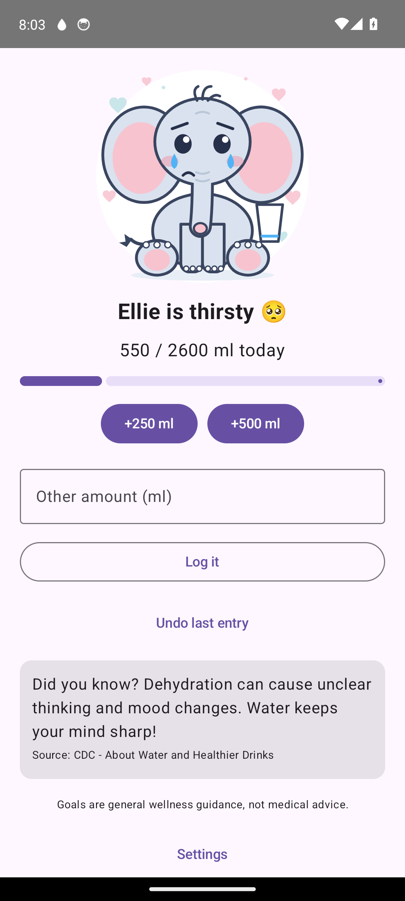

